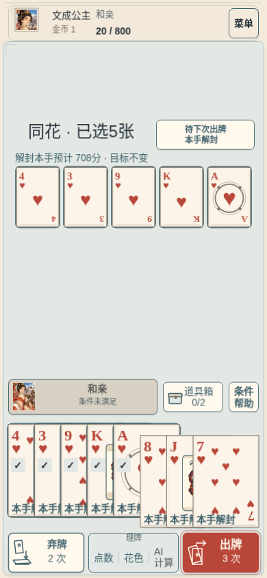
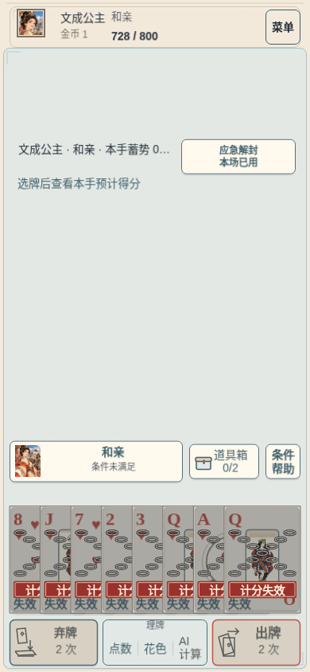

# B03 新局应急解封

当前合同：用户明确“不需要接上我这局，我新开就是”。**仅新开局接入救场身份；旧身份、旧档原规则继续/重试/导出。无迁移入口、无跨分区改写、无补快照，未操作用户实际存档。** PR224 的早期迁移审查保留作历史，现已解除其实施阻点。

基线：远端 main `635d7ec56f26b418689ab0fcbe472a67d924489b`。开发分支 `feat/b03-emergency-rescue-20261022`。未合 B2、未动隔离实验、未推 main、未查部署、未启动 Astra。

## 行为与事务

- 入场按全部存活扑克的 `id/suit` 快照及绑定原入场收据的摘要锁定资格：非空、B03、全副都是当场禁用花色。不是按手牌判断；战中删牌/染色/复制不重算资格。
- 固定“应急解封”入口：5 金，本场一次，不占消耗品格。未买／待下次出牌／本场已用清楚区分；钱不足仍可查看说明。
- 确认后走 `BuyBossSuitRescue` → 原 `SavedRun` 候选保存事务。成功落盘才发布扣款与待用状态。失败保持已发布金币/状态，菜单重试落盘同一候选；双击不重复扣款。没有退款或重买命令。
- 待用时允许正常弃牌、工具准备；下次合法出牌成功提交才消耗。非法选择、取消和预览不消耗。结算失败/保存失败均不发布消耗；冷恢复读取真实收据。
- 仅豁免 B03 的花色失效，Boss 身份继续是 B03。原花色/点数/增强/版次/花色协同保持。原计分、玻璃、成长、角色和清场时点不重排；本手结算完成后恢复封禁。无额外出牌/弃牌次数，无目标削减或过关保证。
- 牌面移除失效链并标“本手解封”，按实际所选牌和角色选择显示公共预览范围；随机效果仍是范围，不读取真实规则 RNG。历史结果带本手豁免事实。PC 横版与手机竖版的入口触区为 144×44，手机减少动态也有静态文字状态。

新身份是在原四种当前发布 house 身份上追加 `-b03-rescue-v1` 及独立 hash，保持各角色、a11 与其他原规则委托。旧 hash、规则 JSON 和原身份常量未重写。`RunLaunch.newRunIdentity` 只影响新开；`retry` 返回所存原身份。保存落盘/重试队列和 IndexedDB 分区/备份方法未修改。`SavedRun.dispatch` 仅对新身份在生成命令前补齐本项的入场摘要/购买出牌序号；原身份原样返回原命令。

## 双端真实浏览器流程

命令：`node harness/b03-rescue.mjs`。两例 PASS，无 pageerror：Chromium 151，PC 1366×768 鼠标；手机 390×844 触屏仿真＋减少动态。**非物理真机、非用户存档还原、非自然获取工具/S04的长局验证。** 使用隔离浏览器内通过现有 checkpoint 校验的受控整副红桃 B03 夹具；入场和之后的操作均是真实命令。

同一短局：先合法打出一手，仍有 3 次出牌、6 金。取消不改状态；连续双确认注入一次保存失败，金币仍 6、存储不变；菜单重试后只一条购买收据、金币 1。待用冷恢复后先正常弃牌，额度保留，再点选五张同花：预览 **708**、实际 **708**，累计 **728/800**，尚未过关。随后牌面恢复失效链；已用冷恢复不返机会；下一次正常出牌 **20**，active scoring 为空。牌组所有实例的原花色/点数/增强/版次没有因救场改变。

| 阶段 | PC 横版 | 手机竖版（减少动态） |
| --- | --- | --- |
| 购买确认，明示 5 金及不保证过关 | [截图](pc-confirm.png) | [截图](phone-confirm.png) |
| 待用、五张同花牌面、708 分预览 | [截图](pc-pending-preview.png) | [截图](phone-pending-preview.png) |
| 本场已用、728/800、封禁恢复 | [截图](pc-used-sealed.png) | [截图](phone-used-sealed.png) |





完整观察值：[browser-report.json](browser-report.json)；被测源码与构建哈希：[verification.json](verification.json)。服务和浏览器由 harness 的 finally 关闭。

## 有限软件验证

- `tests/b03-rescue.test.ts` 新增 12 项：全副同禁色/混色/空组/只手牌同色/非 B03、存活牌快照、4/5/6 金、已出牌仍可买、一次额度、弃牌与工具保留、原红桃协同/增强/版次、非法/预览不消耗、购买和出牌保存失败精确重试、三态冷恢复、双击、通关当手与下一场。
- 相关既有保存/命令、原 Boss 计分/保存/工具/牌面/历史、a11/角色身份启动及受影响的 route 入场收据测试按下列窄清单执行：**13 文件、217 passed、0 failed**；不扩无关矩阵。
- `npm run build`（含 `tsc --noEmit`）通过；仅既有 Vite 大包提示。
- 首次精确 head CI/本地复现：5057 passed、1 failed。失败是 `xin-refill-lock` 合成旧局夹具只换身份却残留新专属字段；改用夹具既有的“指定原身份创建”参数，保留生产严格校验。修复后该文件 7 项＋B03 9 项共 **16/16**；没有修改辛弃疾产品代码。原 CI 和本地失败分别见 [CI 原失败](ci-first-FAIL.json)、[本地原失败](ci-local-repro-FAIL.txt)。
- [initial-failures.json](initial-failures.json) 保留夹具/类型检查失败与修正；[browser-initial-FAIL.json](browser-initial-FAIL.json) 保留环境缺视频 ffmpeg 的失败，改交截图序列；[phone-caption-before.png](phone-caption-before.png) 保留发现的旧状态文案碰撞画面。最终截图已收口，仅在出现救场入口时调整原占位/状态文字范围。

```sh
npm test -- tests/b03-rescue.test.ts tests/recovery-save.test.ts tests/r2-command.test.ts tests/c03-boss-score.test.ts tests/c03-boss-save.test.ts tests/c03-boss-tools.test.ts tests/boss-card-visual.test.ts tests/saved-boss-impact.test.ts tests/a11-house.test.ts tests/amo-launch.test.ts tests/xin-refill-lock.test.ts tests/route-growth-run.test.ts tests/route-growth-facts.test.ts --reporter=dot
npm test -- tests/xin-refill-lock.test.ts tests/b03-rescue.test.ts --reporter=dot
npm run build
node harness/b03-rescue.mjs
```

## 恢复反例的持久证据修复

父独审提出的最小反例已实际验证：在 `4d155832` 上保留原 receipts、只重算普通 checksum，删入场快照项、改入场花色、合法 used 后再正常出一手再改回 pending（空日志）三例均曾被读取。原始结果保留在 [save-counterexamples-before-FAIL.json](save-counterexamples-before-FAIL.json)，删除购买记录变体的原结果见 [erased-purchase-before-FAIL.json](erased-purchase-before-FAIL.json)，不把浏览器正常流程当作排除证据。

窄修：入场命令带整个存活 `id/suit` 序列的摘要，领域在真实入场前与完整牌组核对；快照必须复现该原命令的 receipt fingerprint。购买命令带同一入场摘要和购买时 `playIndex`，也绑定原购买收据；`pending` 必须仍处于这个出牌序号，任何成功出牌推进序号后都不能回到待用。未带可绑定入场证据的纯领域状态不发放救场资格，真实应用 dispatch 自动提供。购买记录缺失时，也按本场有限出牌序号重建可能的购买命令，与常驻原收据比对，禁止清空可选记录后重买。原角色入场边界校验仅适配这个明确的新参数，不重写其他收据。

回归包含：删至一张/改花色；同步重算 token+checksum 仍不改原收据；journal 为空或购买落出 256 条窗口；used 后再正常出牌使 lastTrace 不含豁免，再回滚 pending；同步篡改购买序号；删除购买记录退回未买。现均拒绝。真实 SavedRun 入场/购买字段生成、显式错误摘要/序号、空日志正向恢复和原保存失败重试也通过。此修复只完善未发布救场身份的合同 hash；所有已发布旧身份 hash 保持原值。

## 受影响文件和方法边界

- 新 `r2BossSuitRescueIdentity.ts` / `r2BossSuitRescue.ts`：合同/身份、快照、资格、三态、有效失效牌和购买可用性。
- `r2GroupUpgrade.ts`：保留原 house 条目，追加救场身份；`r2RouteGrowth.ts: validR2RouteStage` 仅适配有入场摘要的新命令收据；`RunLaunch.ts`：新开身份一处包装，重试保原身份。
- `run.ts`：单一购买 Action；`r2Run.ts`：stage 类型、不变量、entryStage、refreshDisabled、r2ScoreContext、购买分支、成功出牌完整结算后的消耗。`r2ToolCommands.ts`：工具之后刷新失效牌也使用同一窄豁免。
- `scoreR2.ts`：输入和 trace 只追加绑定购买收据的豁免事实，不改计分时钟/事件序列。`checkpoint.ts`：按新身份校验新增 stage/trace/Action 字段，绑定完整入场摘要、购买出牌序号、收据与日志次序；即使日志丢失也验证原收据和购买时钟，旧身份禁止这些字段。
- 新 `BossSuitRescue.ts`：三态文案与独立购买确认；`BossPressure.ts` / `SavedBossImpact.ts`：当前和历史读取豁免事实。
- `GameScene.ts`：新窄按钮及确认派发、压力上下文、解封牌面标记、公共分数预览；有救场入口时预留标题/状态文字宽度。未改 layout、理牌、选角、苏轼特效或 iPad 专项。
- 新 `tests/fixtures/b03-rescue.ts` / `tests/b03-rescue.test.ts` / `harness/b03-rescue.mjs`：披露的受控夹具与有限验证。

与另一 B2 任务潜在冲突：**r2GroupUpgrade、r2Run、run Action、checkpoint、GameScene、RunLaunch**，另需核对 `SavedRun.dispatch`、`r2RouteGrowth.validR2RouteStage` 的窄入场事实参数；另有工具/score trace 的小调用边界。未改其隔离脚本，父任务统一整合。`SavedRun.ts` 仅改 dispatch 的本项命令事实补齐，落盘/重试/发布逻辑原样保留。未改 `IndexedDbSave.ts`、`session.ts`、`r2ContentProfiles.ts` 或共享规则 JSON。

入口回退：只撤掉 `newRunIdentity` 的救场包装即可停止后续新局选择新身份，同时保留新身份读取/运行代码让已经创建的救场局继续。整包回退会让新增身份档不可读，不能冒称无损保存回退。

未验：物理 PC/手机设备、听感、自然长期平衡、所有英雄在所有 Boss 下的组合。无旧局迁移待办，无部署结论。
