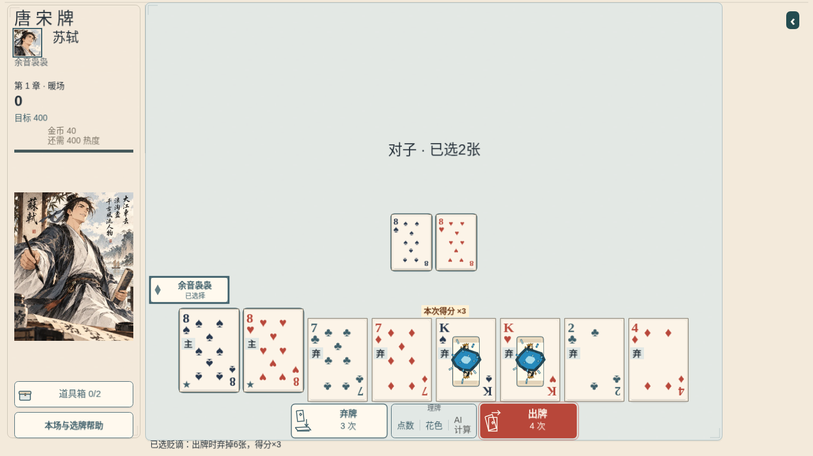

# 苏轼真实代价 K 蓝色牌心蓄势

源码基线 `9abedd0195881c64c730f13e26b66c54f94b3716`；最终采集源码/测试 head `2dbc52771f9bdc5fbc35e595de5cdf6c38a4905a`，采集时工作树干净。后续只补齐苏轼旧专测的 mock/断言与本目录证据，生产演出源码与采集版本相同，不冒称用户已验收。唯一索引见 [index.json](index.json)。

先看[原速 MP4](process-1x.mp4)（29.4 秒，1×，没有变速）或[原始 WebM](process-1x.webm)。视频包含真实选择、确认/取消/改选、菜单/失焦检查、实际出牌与减少动态。受控、可读检查点只用于准备合法牌序；选择、技能确认、出牌和保存均走真实 UI/命令。新局真实得分 `102 ×3 = 306`，不是渲染代码补分。

## 实际改动与交接

- `SushiKingEnergy.ts`：12 个固定复用的解析粒子槽、3 层不规则墨线牌心，局部向心聚拢，碎裂前收束释放；用已有 Graphics/共享时钟，不增加依赖、纹理、计时器、Three.js 或生成素材。短轨迹保持在 K 的局部范围。
- `SushiDiscardCardPresentation.ts`：只准备真实余牌中的 K，主手 K 不参与。重复刷新复用原对象。保存成功后用真实事件倍率绑定原来的牌面；与计分层按同一容器身份交接，不叠两套蓝团，不销毁来源卡。蓝团不恢复旧烟雾/刺客/火焰。
- `SushiKingCharge.ts`：沿现有 score Tween 采样，在现有 `windup ×0.62` 真 K 碎裂入口前释放；保原姿态恢复、abort/shutdown/隐藏清理，补重复绑定与 blur 清理。现有 `SushiSkillPayoff.ts`、倍率传送和 `SushiDiscardExit.ts` 没改。
- `GameScene.ts` 仅两处必要苏轼演出接线：`syncHeroTargetAttachment` 的 `usesAmoExile` 分支立即准备；`presentTrace` 队列的非回放真实 `amoExile.use` 分支绑定保存事件。父协调追加允许此最小接线后才修改。没有改技能弹窗、理牌、布局、选角/路线、其他英雄、规则、数值、存档或计划台账。

规则仍为丢弃主手之外的真实余牌，只有其中的 K 蓄势；不是把任意一张 K 改为代价。新局真实 UI ×3；旧身份 ×4 用真实旧档身份创建对局、执行领域命令得到 `408` 再绑定显示，专属测试没有改成另一套生产规则。

## 有限验证

`tests/sushi-*.test.ts`、`tests/amo-exile.test.ts` 和 `tests/amo-exile-visual.test.ts` 共 11 文件、64 项通过。新增测试覆盖即时蓝色输出/固定池复用、静态核心、主手 K 排除、重复绑定、abort/隐藏/blur/shutdown/源销毁、真实 ×3/旧身份 ×4 交接。`typecheck`、生产构建通过；构建保留已有大 chunk 提示。

[实际浏览器报告](after.json)验证确认后的**首个已选择帧**即有 `spades-13`、`hearts-13`；出牌至该角色事件前保持两张 K 蓄势；计分层接管时旧层消失且来源卡仍活跃、alpha=1；随后现有真实 K 碎裂、一个 `×3` 飞入技能区并落金字。完整状态与 `applyCommand` 结果严格一致。两个 K 以外的来源、旧烟雾均未出现。

减少动态保留[静态蓝色牌心与“本次得分 ×3”说明](reduced-static.png)，400ms 内绘制缓冲不变化，真实结果仍为 306；全动态和减少动态结束后都没有活跃的 `hero/sushi*` 对象。

## 同环境开销与边界

最终前后采集串行运行，1366×768、Chromium `151.0.7922.173`、1×、同一个环境与记录器，每阶段约 1.8s。没有并行构建/测试负载；只测本次两张 K，没有扩设备矩阵。原始数据：[before.json](before.json)、[after.json](after.json)。

| 确认技能后的样本 | 基线 | 本次 |
| --- | ---: | ---: |
| 帧间隔中位数 / p95 | 16.8 / 20.7ms | 16.5 / 21.5ms |
| attachment update CPU 中位数 / p95 / 最大 | 0.1 / 0.2 / 0.9ms | 0.2 / 1.9 / 3.1ms |
| 活跃场景对象 | 306 | 311 |
| 场景 Graphics 命令 | 6468 | 7764 |
| 整段计分对象峰值 | 276 | 276 |
| 结算后对象 / Graphics 命令 / 纹理 | 242 / 5370 / 249 | 242 / 5370 / 249 |

CPU 是整个 attachment update 的采样，含既有标签与遮挡计算，不是蓝色几何独占耗时；数字受软件浏览器、录屏和计时分辨率影响。可确认本环境两张 K 增加了有限绘制与 CPU 工作、结束后对象清理；**不能保证零性能影响、总体帧率改善或真实 iPad/GPU 表现**，未测 JS heap/GPU 显存。最多 8 个目标/每个 12 个解析粒子槽是代码硬界限，不冒称 8 张 K 实机实测。

前一次真实 UI 样本的 attachment CPU p95 为 5.1ms，去掉本段重复量取整屏美术遮挡后最终为 1.9ms；没有削减其他效果补预算。最早 ffmpeg 路径缺失与明确未接线的模块演示都保留在 [attempts.json](attempts.json)，没有把它们写成最终完整 UI 验收。

浏览器、上下文和 Vite 服务由 harness 的 `finally` 关闭；本路仅开发分支/PR，父任务统一审查合 main。用户美术/听感与物理设备验收仍待实际观看，不查试玩站、不恢复 Astra 选角工作。

首次远端全量 CI 为 415 文件/5032 项通过、1 项旧苏轼专测失败：旧 mock 没有即时入口 `previewSushiKings`。仅更新这份苏轼专测为新授权行为，并核验真实余牌、主手 K 排除、取消/失去资格及原状态不变；没有改生产代码或重录画面。原始失败、精确 head/run/job 与原因见 [ci-first-failure.json](ci-first-failure.json)。最终 CI 以 PR 最新 head 为准，不用旧失败或采集 head 冒充。
