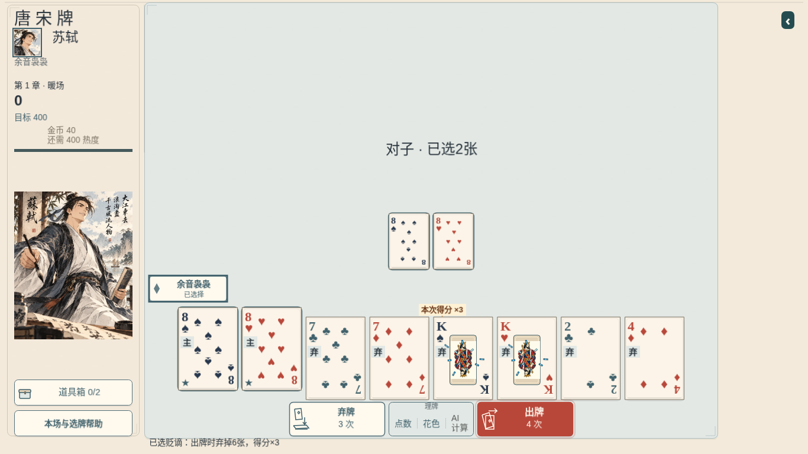

# 苏轼 K 蓄势：仅去中心填充

按用户确认的拆法，只删除 `SushiKingEnergy.draw` 的三层中心填充：亮点 `LIGHT/.33`、蓝圈 `BLUE/.79`、深蓝外缘 `INK/1`。同时去掉该中心专用的点数组、半径和预算字段。**外围变化虚线整个循环不动**，包括原色、12 槽、`clock/840`、轨迹、透明度、线宽、小尖粒与释放参数。整张 K 细边框不动，没有新增美化。

基线为本轮 fetch 到的 main `70b0581d8ac5c9e8c2b877fc95dc4f7328d8854f`。采集时干净 head 为 `8a0f611d38ee06d49449dcccfb70814d54c79510`，生产差异只有 `src/game/SushiKingEnergy.ts`，`+2/-9`。GameScene/理牌、K 边框/生命周期、真实倍率飞行、K 碎裂/弃牌、规则和 Astra 选角文件与基线逐字节相同，hash 见 [index.json](index.json)。本路只提交 PR，由唯一集成线程串行合并。

[15.28 秒原速 MP4](process-1x.mp4) · [原始 WebM](process-1x.webm) · [两次虚线位置截图 A](armed-a.png) / [B](armed-b.png) · [保留 K 细边框的计分阶段](score-dashes.png)

验证范围：

- 在删除前，用本轮 main 的真实 Phaser Graphics 记录 3 个时刻的绘制调用，单独排除三次中心填充；删除后每帧剩余 72 次矢量调用逐参数相等，验证原线色/数量/速度/轨迹/尖粒没有变化。参考为 `tests/fixtures/sushi-motes-before-core-removal.json`，不是重写一套轨迹公式。
- 苏轼及规则相关 11 文件、68 项测试、typecheck、生产构建通过。减少动态不再画中心；已有倍率静态说明与无动画分支保留。仅调整旧专测中对中心填充的期待，以及旧 browser harness 对减少动态静态标识的断言，没有重跑其大流程。
- 本次短片仅一个 1366×768 Chromium、1×、一手合法受控检查点后的真实 UI 选牌/技能确认/出牌。观察到 208 次能量绘制，没有十点中心多边形，保留 24 段描线和 12 个四点尖粒，且轨迹持续变化。实际 8 片 K 碎裂、一个 ×3 传送与金字落定仍有观察；实际得分 306、倍率事件 ×3，完整状态及实际保存严格对齐领域命令，结束后预备对象为 0。

浏览器原始观察保留为 [browser-report.json.gz](browser-report.json.gz)。没有新做性能比较、其他设备/英雄矩阵或 iPad 排查，不以本次删绘制承诺帧率收益。原速素材没有变速，未代用户再次审美签收。

浏览器、上下文和 Vite 服务已在 harness `finally` 关闭；没有修改 main、旧证据或计划台账。

采集后仅补一条减少动态专测，确认两张代价 K 共用一条真实倍率说明，并修正旧 browser harness 对此的断言；生产代码与上述采集 head 完全相同，没有重录或改变画面。

## 独立集成收口

PR220精确head `a7b77c84fb1a1d2510a17277c80b2c010748b992` 完整CI39615942852/计划39615942283均success，已合main `786df0936b1404508dd9988eead7d66413d458a7`。独审见[integration-review.json](integration-review.json)：外围循环逐字相等、3时刻72次绘制调用逐参数相等、原媒体hash与采集源码相同；当前组合对PR219 main只改SushiKingEnergy，旧sortHand/其它生产文件保留。4文件24项最小专测通过（含旧理牌回滚），未重录或扩矩阵。录像仍明确来自删层采集head，非事后冒称整合版全量重跑。必要计划收口无生产改动，最终含文档main SHA/CI见交付回执。
